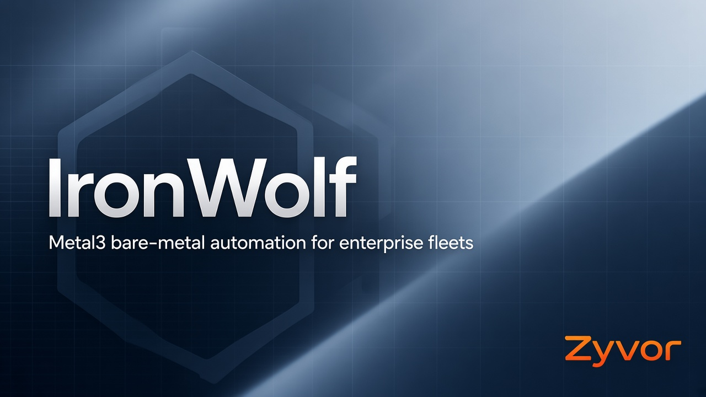

<div align="center">

# IronWolf

[](https://zyvorai.github.io/zyvor-ironwolf-site/)
[](https://metal3.io/)
[](https://kubernetes.io/)
[](LICENSE)

[](https://zyvor.dev/schedule?utm_source=github&utm_medium=ironwolf&utm_campaign=readme_hero)
[](https://zyvor.dev/poc?utm_source=github&utm_medium=ironwolf&utm_campaign=readme_hero)
[](https://zyvorai.github.io/zyvor-ironwolf-site/)



### Claim the metal. Keep the fleet honest.

**IronWolf extends Metal3 Bare Metal Operator** with enterprise fleet automation: ClusterClaim scheduling, firmware compliance, host quarantine, two-person approvals, and a production dashboard — packaged so `helm install` feels finished.

**ClusterClaim + what-if** · **Fleet health grade** · **Quarantine** · **Approvals** · **Product package seeds**

[**Docs site**](https://zyvorai.github.io/zyvor-ironwolf-site/) · [**Library**](https://zyvorai.github.io/zyvor-ironwolf-site/library.html) · [**OpenAPI**](docs/openapi/ironwolf-dashboard-api.yaml) · [**Talk to Zyvor**](https://zyvor.dev/?utm_source=github&utm_medium=ironwolf&utm_campaign=readme_hero)

</div>

---

> **This repository publishes documentation and the product site only.** There is no product source code here. Operator images, Helm charts, and the dashboard ship with your commercial package; this page describes them.

## Why IronWolf

| When this happens… | IronWolf gives you… |
|---|---|
| You need bare metal for a control plane and workers, yesterday | ClusterClaim scheduling with binpack, spread, or topology-aware strategies |
| You’re not sure the claim will fit | What-if dry-run and a capacity plan against live inventory |
| Firmware drift is invisible until something breaks | Fleet firmware compliance with JSON and CSV export |
| A host is unsafe but still in the pool | Quarantine that blocks destructive mutations until cleared |
| Power-off / deprovision needs two people | Approval workflow with optional Slack or webhook notify |
| Helm left you with a blank install | Product package seeds: branding, notify prefs, starter AlertPolicy, readiness API |

IronWolf sits on Metal3 BareMetalHost. It does not replace Ironic or BMO — it automates the day-2 fleet around them.

## What’s in the product package

| Area | What you get |
|---|---|
| **Operator** | CRDs and controllers for claims, pools, firmware, power, energy, security, remediation, backups, restores |
| **Dashboard** | Store-style UI for hosts, claims, approvals, capacity, firmware compliance, observability |
| **Helm seeds** | `values-production.yaml` + `values-package.yaml` for branding, notify prefs, starter AlertPolicy |
| **Readiness** | `GET /api/v1/package/readiness` checklist for CRDs, operator pods, Grafana, approvals |
| **Fleet ops** | Health score, quarantine, dry-run, capacity plan, WS fan-out for approvals and bootstrap jobs |
| **IaC** | Terraform typed resources and Crossplane composition examples (with your package) |

## Install

Needs a cluster with Metal3 Bare Metal Operator (and Ironic for real hardware). Charts and images come with the commercial package.

```bash
helm upgrade --install ironwolf oci://ghcr.io/zyvorai/charts/ironwolf \
  --namespace ironwolf-system --create-namespace \
  -f values-production.yaml \
  -f values-package.yaml \
  --set dashboard.observability.grafanaUrl=http://HOST:30301

# Package readiness
curl -sS -H "X-API-Key: $IRONWOLF_API_KEY" \
  https://dashboard/api/v1/package/readiness
```

Full walkthrough: [docs/getting-started.md](docs/getting-started.md) · Helm reference: [docs/helm-values.md](docs/helm-values.md)

## Documentation

📖 **[Browse the docs site](https://zyvorai.github.io/zyvor-ironwolf-site/)** — landing, library, and guides.

| Guide | |
|---|---|
| [Getting started](docs/getting-started.md) | Install, license, first claim |
| [Using the dashboard](docs/customer/using-the-dashboard.md) | Approvals, quarantine, capacity |
| [Production checklist](docs/production-checklist.md) | Operator runbook (ops gates) |
| [Hardware certification](docs/guides/hardware-certification.md) | Matrix + physical BMC profiles |
| [OpenAPI](docs/openapi/ironwolf-dashboard-api.yaml) | Dashboard REST contract |
| [Architecture](docs/architecture.md) | Operator + dashboard + Metal3 |
| [Operations](docs/operations-guide.md) | Day-2 runbooks |
| [Troubleshooting](docs/troubleshooting.md) | Common failure modes |

## What we don’t claim yet

- Controller unit coverage is still climbing toward a 50%+ campaign on a large upstream BMH surface — not a package install blocker.
- Physical BMC certification profiles are secret-gated (`IRONWOLF_BMC_*`) and run in nightly CI when configured.
- Lab release E2E and Terraform Registry publish need CI secrets on your side.
- Production HA (TLS, Redis WS bridge, license) is an operator runbook, not a checkbox we flip for you.

## Talk to Zyvor

[Book a demo](https://zyvor.dev/schedule?utm_source=github&utm_medium=ironwolf&utm_campaign=readme_cta) · [30-day PoC](https://zyvor.dev/poc?utm_source=github&utm_medium=ironwolf&utm_campaign=readme_cta) · [sales@zyvor.dev](mailto:sales@zyvor.dev)

---

<div align="center">

**IronWolf** by [Zyvor AI Labs](https://zyvor.dev) · © 2026 · [Site](https://zyvorai.github.io/zyvor-ironwolf-site/) · [License](LICENSE)

</div>
